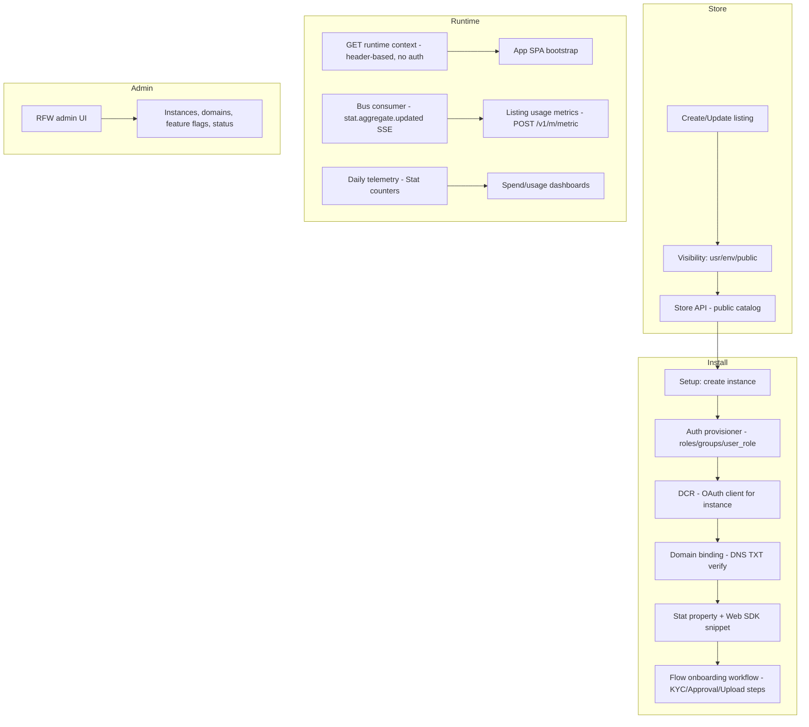

# Design Doc: Sentin8:App — Third-Party App Store & Instance Management

## 1. Summary

Sentin8:App is the platform's app store and app-instance lifecycle
service. Developers publish store listings (with declared security roles
and visibility tiers), organizations install listings into environments
as app instances (provisioning roles/groups, OAuth clients via DCR,
domains, and feature flags along the way), and runtime context is
served to the app's SPA per request. The service delegates onboarding
orchestration to Sentin8:Flow, metrics to Sentin8:Stat, and events to
Sentin8:Bus.

## 2. Motivation

- **Apps are tenants too.** Third-party apps need provisioning surfaces
  (roles, groups, memberships, OAuth clients) without ever touching
  other services' tables — the app store is the composition point where
  an install becomes a full stack of platform resources.
- **Backend URL is metadata, not configuration.** App:App is a platform,
  not an app registry with backend knowledge: the developer's
  `backend_url` is stored on the listing and consumed by others; the
  BFF hostname pattern (`bff.{app_domain}`) is derived, never
  hardcoded.
- **Visibility is a product decision.** Listings are `usr`, `env`, or
  `public` scoped; the store API filters by the caller's perspective,
  and RLS enforces the same tiers on the tables.
- **App lifecycles need workflow machinery.** Onboarding (KYC check,
  approval review, document upload) is a multi-step compensable process
  — a natural Sentin8:Flow workflow with proxy-back steps.

## 3. Architecture & High-Level Design

- **Store API** — public catalog of listings (`usr`/`env`/`public`
  visibility tiers enforced by visibility-scoped RLS); catalog admins
  manage listings via the admin API.
- **Setup** — installing a listing provisions the full resource stack:
  Auth roles (per the listing's declared roles, each carrying its own
  scope set), groups, the default signup role wiring, an OAuth client
  (DCR), a domain (default `{app}.{env}.{org_domain}` or DNS-verified
  custom), a Stat property, and the embeddable Web SDK snippet.
- **Runtime context** — header-based (no auth) endpoint the app's
  frontend bootstrap calls to learn its instance context.
- **Flow integration** — App registers its step-handler profile
  (domain `app`); Flow calls back `POST /v1/internal/steps/execute` for
  `KYCCheckStep`, `ApprovalReviewStep` (delegates to Flow's
  `ManualDecisionStep`), and `DocumentUploadStep`.
- **Authorization** — Shield (`require_policy`) gates admin paths; the
  enforced scope-mirror set over LIVE effective scopes is the only
  gate. Cross-env admin calls REQUIRE `target_env_id` — no fallback to
  the token's env, never defaulted.

## 4. Key Traits and Data Structures

- **`StoreListingResponse` / `CreateListingRequest` /
  `UpdateListingRequest`** — the listing wire types: identity, backend
  URL metadata, DCR support, OAuth defaults, visibility tier,
  declared `ListingRole`s (name + scopes), and `default_signup_role`.
- **`SetupRequest` / `SetupResponse`** — install: listing id, instance
  naming, optional custom domain, the org's selected Auth URL, and the
  public sign-up flag.
- **`AuthProvisioner`** — the Auth membership provisioning client
  (DCR-backed M2M token source cached per process); verbs for role,
  role nesting, group, group role, group member, user role. App never
  INSERTs `auth.*` tables — the owner exposes the verbs.
- **`OAuthClient` + `DcrError`** — the RFC 7591 DCR result stored on the
  instance record (`client_id`, optional `client_secret` for
  confidential clients, issued-at).
- **`DomainBinding`** — FQDN + instance + DNS TXT verification token
  (SHA-256-derived); custom domains verify via TXT record challenge.
- **`StepExecuteRequest` / `StepExecuteResponse`** — the Flow
  proxy-back contract for App's step kinds.
- **`StatEventListener`** — the SSE Bus consumer for
  `sentin8:stat.aggregate.updated` events on the `stat-pipeline` family;
  applies each event as a listing usage metric through Stat's ingest
  surface (`POST /v1/m/metric`, the shared `sentin8:stat:measure` M2M
  token; the event's property_id is the listing's property) and ACKs
  (reconnect with 2s backoff; ACK-only when no stat token source).

## 5. Rationale, Trade-offs, and Alternatives

- **Provisioning through the owner's API, never its tables.** Instance
  setup calls Auth's provisioning endpoints; cross-service table access
  is prohibited (no grant, no matter how convenient). Trade-off: a
  per-install round trip per resource, accepted for isolation and for
  keeping Auth the single authority on its own rows. The client is a
  deliberate copy of sys's provisioner (peers cannot share a crate —
  dependency direction is one-way).
- **Visibility tiers without an `org` tier.** `usr` (per-user),
  `env` (per-environment), `public` (platform). Org-wide visibility was
  dropped — it is achieved via `public` or per-env replication; a
  separate org tier duplicated both and blurred the RLS policy shape.
- **Roles declared on the listing.** The app developer declares the
  roles (and scope sets) the app needs; install provisions them so
  admin UIs can assign real roles on day one. Trade-off: a malicious
  listing could over-declare scopes — mitigated because scope grants
  evaluate against the platform vocabulary and the DCR grant closure.
- **`default_signup_role` as a listing field.** Env-realm sign-ups need
  a baseline role; keeping it listing-level (not per-role) makes the
  auto-assignment decision visible in one place and required to be one
  of the declared roles.
- **Header-based runtime context (no auth).** The bootstrap endpoint
  answers with instance context derived from headers; the SPA then
  authenticates normally through the BFF. Authenticating bootstrap
  would create a chicken-and-egg for the SPA's very first load; the
  context carries no secrets (tokens never reach the client).
- **DCR per instance.** Each app instance gets its own OAuth client
  (RFC 7591) so revocation and branding are per-tenant. Shared
  per-listing clients would couple tenants' auth lifecycle. The
  `redirect_uri` is the derived BFF callback
  (`https://bff.{hostname}/auth/callback`); when the listing declares
  an `oauth_defaults.redirect_uris` allow-list the callback MUST match
  one of its entries exactly — a mismatch fails the install (400)
  rather than registering an off-list callback (no key → derived
  callback is the default).
- **Domain derivation over wildcard.** Every subdomain derives from the
  org's entered domain (custom or `{slug}.{base}`); the obsolete
  `*.app.{base}` wildcard pattern is gone — a wildcard certificate per
  org was the rejected alternative (certificate sprawl + verification
  ambiguity).
- **Stat listener as an SSE consumer.** Aggregate-updated events arrive
  over Bus (push, no polling); the listener ACKs and reconnects with
  backoff. A polling loop would multiply Bus traffic for the same
  effect.
- **Daily telemetry via Cron + Stat.** `instances.count`,
  `listings.count`, `installs.daily` counters (dimension: env) —
  emission is scheduled, idempotent, and fire-and-forget; the M2M client
  is DCR-registered (scope `sentin8:stat:measure`) with credentials
  persisted for restart.
- **Events via local outbox.** Domain changes write an `inbox` row in
  the same transaction (tenant context set inside one transaction —
  the context is transaction-local), so events are durable exactly when
  the domain write commits.
- **Rejected: instance setup as one synchronous transaction.** The
  install touches Auth (roles), Auth (DCR), domains (DNS), and Stat —
  a distributed transaction across services is not achievable; the Flow
  workflow with compensating steps is the durable equivalent.

## 6. Internal Implementation & Invariants (Private Design)

- **Invariants:**
  - Cross-env admin calls require `target_env_id` validated via RBAC —
    REQUIRED, no fallback to the token env.
  - RLS context is set on the SAME connection, inside the same explicit
    transaction as the dependent statements (transaction-local
    `set_config`; a separate context-set would evaporate at commit and
    silently filter every row).
  - Listing role names are unique per `(org_id, env_id)`; a stable app
    prefix (`ebank-admin`) is the convention to avoid collisions.
  - Visibilities are exactly `usr`, `env`, `public` — the `org` tier
    does not exist.
  - The runtime context endpoint is header-based and carries no tokens.
  - DCR secrets are returned once and stored on the instance record;
    listing rows never carry client secrets.
  - Events flow through the local `inbox` (Bus relay) — never a direct
    write to a shared queue.
- **Boot (shell-owned).** The platform shell owns registration, PQ
  provider, config, capped pool, PG18 check, state binding, OpenAPI
  merge, middleware, and the PQ-TLS listener. The state builder
  resolves the provider registry routes and spawns: the Stat event
  listener (Bus SSE consumer), daily telemetry (Cron), and the Flow
  step-handler registration (domain `app`).
- **Setup is a Flow workflow, not a monolith.** The onboarding steps
  proxy-back to App's internal endpoint; `ApprovalReviewStep` pauses in
  Flow's `ManualDecisionStep` until approved. KYC and document upload
  are stubs today — the workflow shape is the contract.

## 7. Unresolved Questions / Future Designs

- Listing review/approval keeps the status field for v1; a review workflow is
  justified when multiple operators need approval gates.
- Per-listing versioning is live (APP-4): a listing row is a
  `(app_slug, channel)` release with an advisory `version`; install
  resolves the newest published version on the requested channel
  (`stable` default). Manifests may pin `version`/`channel`.
- Listing media (APP-3): `store_listings.media` JSONB holds typed
  by-reference entries (`{role, resolution, storage_key}`); bytes live in
  Sentin8:Storage under `app/{listing_id}/{role}.{ext}` — no blobs in
  tables. Categories are a `listing_categories (category, app_slug)` join
  table; `GET /v1/app/store/listings?category=` filters.
- Domain verification supports TXT and CNAME (APP-5): the CNAME challenge
  asks the tenant to point `{token}.verify.{domain}` at the instance's
  platform hostname; the caller submits `{cname_token, cname_target}` on
  the domain-bind endpoint (wins over `txt_record` when both present).
- Usage-based billing stays out of scope (correct): metering rides Stat (usage
  metrics per listing).

---

**Design attribution:** sentin8:app and its underlying concepts were designed by Hamid Jahanzad <Hamid@Jahanzad.com>.
